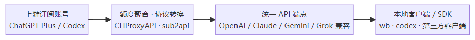
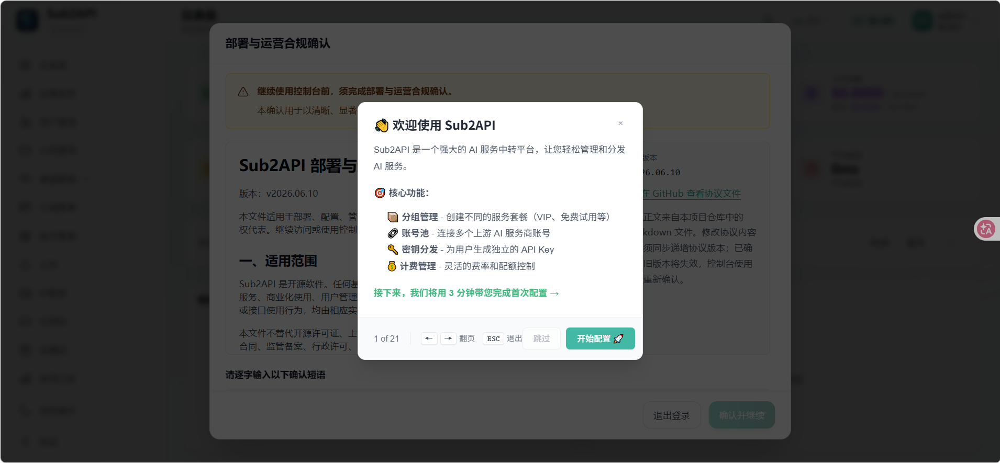
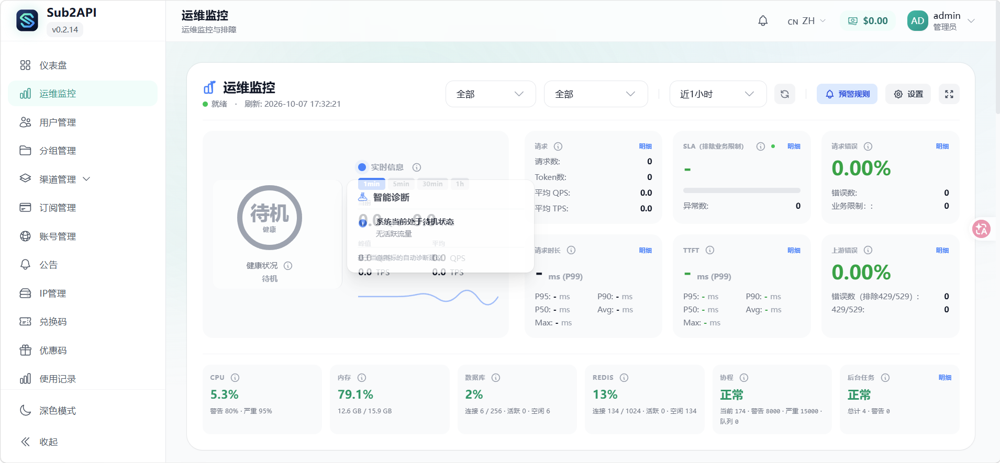
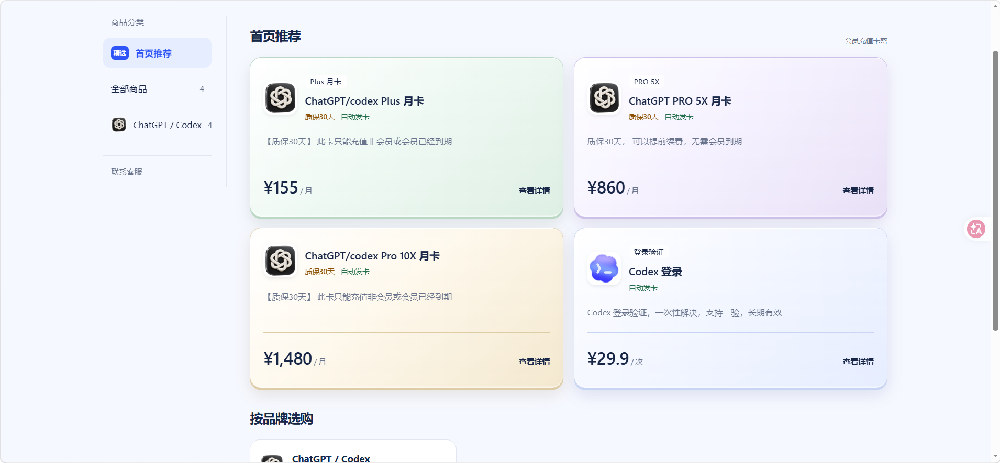

## 账号共享方案-v2-2026-10-7

> | 类别 | 内容                                                         |
> | ---- | ------------------------------------------------------------ |
> | 账号 | ChatGPT Plus ×1（**暂无 Pro 账号，也没有多余的 Plus 账号**） |
> | 工具 | WorkBuddy（下简称 **wb**）、Codex、EasyCLIProxyAPI、sub2api  |
>
> 项目来源:
>
> | 工具                | 项目简介                                                     | 仓库地址                                                     |
> | ------------------- | ------------------------------------------------------------ | ------------------------------------------------------------ |
> | **EasyCLIProxyAPI** | CLIProxyAPI 的桌面图形化管理工具，并可自动配置主流 AI 智能体 | [router-for-me/EasyCLIProxyAPI](https://github.com/router-for-me/EasyCLIProxyAPI) |
> | **sub2api**         | 一站式开源中转服务，让 Claude、OpenAI、Gemini、Grok 订阅统一接入，支持拼车共享，更高效分摊成本，原生工具无缝使用 | [Wei-Shaw/sub2api](https://github.com/Wei-Shaw/sub2api)      |
>
> 下载地址：
>
> | 工具        | 版本    | 下载地址                                                     |
> | ----------- | ------- | ------------------------------------------------------------ |
> | CLIProxyAPI | v0.3.12 | [Release EasyCLIProxyAPI v0.3.12](https://github.com/router-for-me/EasyCLIProxyAPI/releases/tag/v0.3.12) |
> | sub2api     | v0.2.11 | [Release sub2api v0.2.11](https://github.com/Wei-Shaw/sub2api/releases/tag/v0.2.11) |
>
> 方案速览:
>
> 

---

### 1.CLIProxyAPI(目前来看更安全，但需要先小范围共享一段时间看是否会风控)

EasyCLIProxyAPI 是基于 [CLIProxyAPI](https://github.com/router-for-me/CLIProxyAPI) 构建的图形化桌面管理工具。它将内核生命周期管理、OAuth 授权、API Provider 聚合、协议转换、 凭证管理、配额查询、使用记录、模型别名和智能体客户端配置集中到一个界面中。

>关于为什么考虑选用这个，目前官方支持本地反代，但不支持余额再分发
>
>因为怕封号，目前我也只试了一下EasyCLIProxyAPI
>
>详细想要了解Tibo对这两款软件的态度可以看此贴：
>[如何评价Tibo再次公开声明允许反代ChatGPT？ - 知乎](https://www.zhihu.com/question/2077032318611605473)

这里测试主机为系统为win10 所以选择amd64安装包，可根据自己系统按需安装

安装完成后，在**主页左下角 → 新手模式**中完成 GPT 账号绑定，然后按需接入兼容的本地客户端。

测试功能是否正常：可以看到**余额发生减少，但并没有异常扣费**。

在电脑任务栏处关闭 EasyCLIProxyAPI 后，**wb 无法再调用 gpt6.1** —— 说明调用链路依赖该本地代理常驻。

> 上面只是简单演示功能，还有一些疑问会统一写在最后，也欢迎补充，后续有条件后会逐步测试

---

### 2.sub2api(真正意义上的账号共享，网上那些中转站也就是用这个搭建或是在此基础上进行修改)

Sub2API 是一个 AI API 网关平台，用于分发和管理 AI 产品订阅的 API 配额。用户通过平台生成的 API Key 调用上游 AI 服务，平台负责鉴权、计费、负载均衡和请求转发。

**实际上是CLIProxyAPI的强化版**

#### 2.1核心功能

- **多账号管理** - 支持多种上游账号类型（OAuth、API Key）
- **API Key 分发** - 为用户生成和管理 API Key
- **精确计费** - Token 级别的用量追踪和成本计算
- **智能调度** - 智能账号选择，支持粘性会话
- **并发控制** - 用户级和账号级并发限制
- **速率限制** - 可配置的请求和 Token 速率限制
- **内置支付系统** - 支持 EasyPay 易支付、支付宝官方、微信官方、Stripe，用户自助充值，无需独立部署支付服务（[配置指南](https://github.com/Wei-Shaw/sub2api/blob/main/docs/PAYMENT_CN.md)）
- **管理后台** - Web 界面进行监控和管理
- **外部系统集成** - 支持通过 iframe 嵌入外部系统（如工单等），扩展管理后台功能

> tips：使用本项目可能违反 Anthropic 等上游服务商的服务条款。

这里是安装完成后的界面，可以通过一个类似网管的gui网页控制界面进行账号的管理，流量的监控，**不过暂时还未投入使用，只是预览界面，下周用一个一次性的plus账号进行为期一周的测试**

---

### 3.项目之间的对比

CLIProxyAPI、New API、Sub2API 对比分析：
**一句话结论**
如果把这2个平台都归类为“AI 大模型网关”，会掩盖它们真正的设计目标差异：

**CLIProxyAPI 更像“CLI/OAuth 订阅到标准 API 的协议桥接器”。**

**Sub2API 更像“面向订阅配额分发、拼车共享、账号调度的运营型中转平台”。**

也就是说，它们的重叠点在“**都能把上游能力统一暴露成 API**”，但核心能力中心分别落在：

CLIProxyAPI：协议兼容与 CLI 账号接入。
Sub2API：订阅资源池化、API Key 分发、并发与速率控制。

---

### 4.暂未处理问题（欢迎补充)：

- **就目前来讲，额度再分发明显触及了 OpenAI 的底线。容易受到一系列账号风控策略，包括前段时间加强的降智和额度异常，实际上已经很明确地指向了对账号共享的打击。这很重要，所以我认为应该用plus号先测试一段时间，就算第二天就封号，也才亏20美刀**
- 还有就是梯子导致每个人的**ip浮动**会不会对账号造成影响(风控),比如我们同时登录，但每个人IP不同
- 因为在下财力不足只有一个号，故而暂时没做多账号测试 ，理论上来讲这两个都可以多账号余额聚合为API供任何兼容(OpenAI/Gemini/Claude/Codex/Grok)的客户端或者SDK使用，以本地方式或多 CLI 账户访问(但尽量小范围使用)
- 暂时未测试多人登录时会不会导致**memory混乱**
- 防止亏损太多，以上部分问题建议放在会员到期前一个星期测试
- 是否比直接买中转站更划算划算
- 多人使用时 余额是否够用（待拿到pro账号进行验证）
- 相比几个号来回切换 价格和使用体验上是否的确有优势（待验证）
- 还有多个平台比如Gemini、GPT、Claude同时绑定在sub2时如何调度（待验证）

此外目前代充pro10x的价格大概在1500左右，所有如果没有出现更划算的价格的话，尽量还是苹果礼品卡或者visa卡自充比较好

