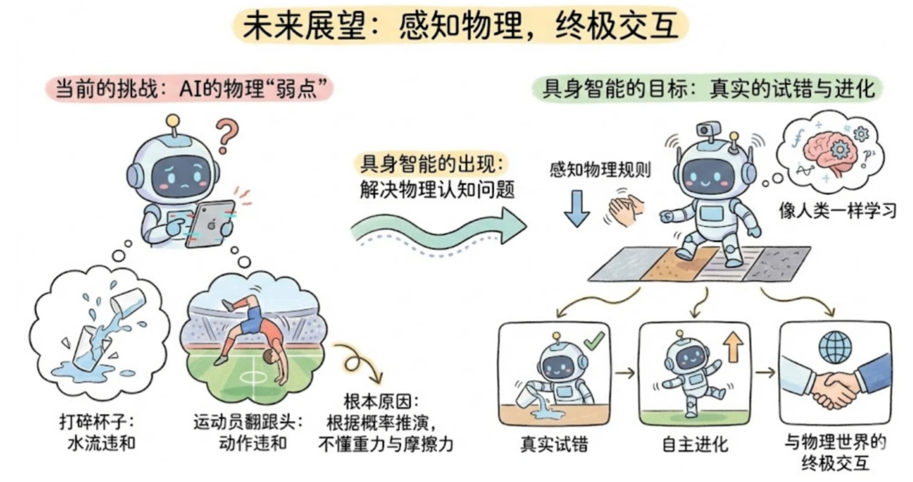
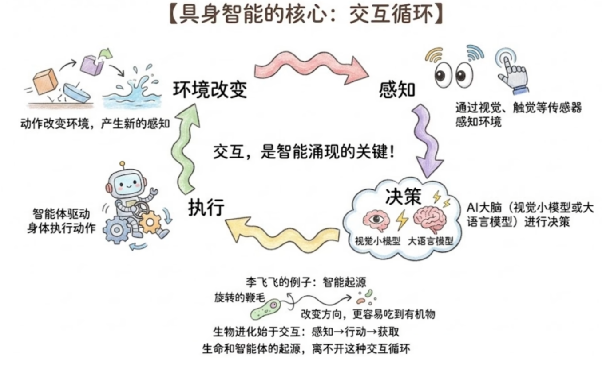
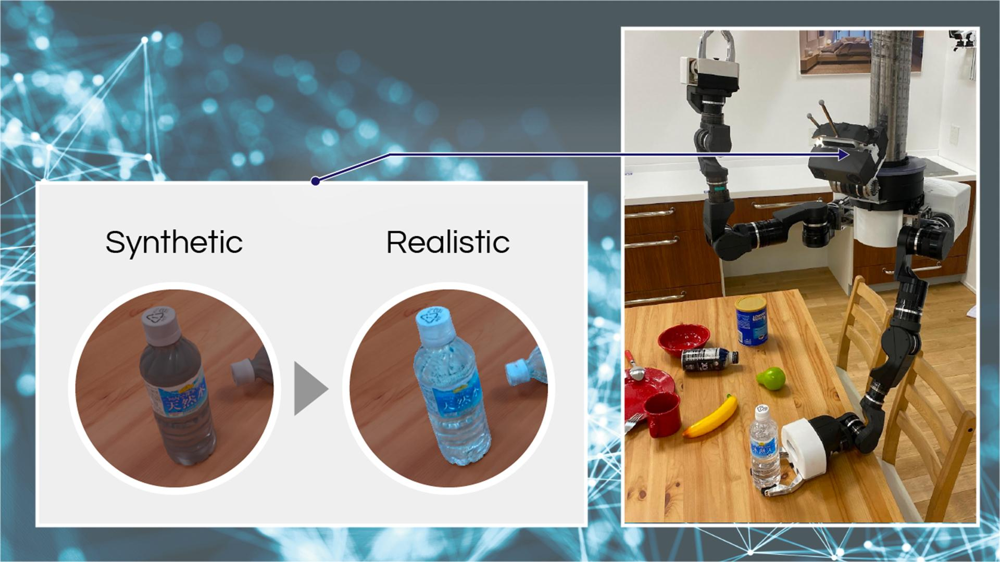

# 组会汇报 · 本周工作

> 汇报日期：2026-10-07
> 本周主线：①精读《ReAct》、《CoT》　；②具身智能基础知识简单了解以及遇到的问题　；③账号共享项目

---

## 1. 学习汇报

| # | 工作项 | 产出 |
|---|---|---|
| 1 | 精读《ReAct》、《CoT》 | 学习笔记(.md) |
| 2 | 具身智能基础知识简单了解以及遇到的问题 | 无 |
| 3 | 账号共享项目 | 账号共享方案-v2.md |

---

### 1.1 论文学习

**一句话结论：**

****CoT 是“分步骤想，再回答”；ReAct 是“边想、边查或操作，根据结果继续想”。**

比如你问：**“A 酒店和 B 酒店，哪家离车站更近？”**

| 方法                                        | 会怎么做                                                     |
| ------------------------------------------- | ------------------------------------------------------------ |
| **CoT（Chain of Thought，思维链）**         | 根据已有知识推理：“A 在市中心，车站也在市中心，所以 A 可能更近。” |
| **ReAct（Reasoning + Acting，推理与行动）** | 先想“需要知道两家酒店到车站的距离” → 调用地图查询 → 看到 A 是 3 公里、B 是 1 公里 → 回答 B 更近。 |

两者主要区别在于：

- **CoT：** 把问题拆成步骤来推理。经典形式主要依靠模型已有知识，可能出现“推理很顺，但依据是错的”。
- **ReAct：** 在推理过程中加入**工具调用和环境反馈**。查不到信息或操作失败时，可以据此调整下一步。

**ReAct 可以理解为在逐步推理的基础上，加上“动手验证和获取信息”的能力。** 不过它并非总比 CoT 好：简单推理题可能不需要工具，而工具返回错误信息时，ReAct 也可能出错。

**个人总结：**

ReAct和cot两篇论文的成果现在基本上市面上的大模型已经都拥有这些能力了 更多的是学习他的论文写作和创新手法 先是抛出一个故事开头告诉读者 以前的是怎么样的 而我的想法是怎么样的 

然后他的创新或者说实验作法就是将两个可以链接的或者说有关联的模块进行拼装 就像搭积木一样 组合成一个新模块 然后在这个新模块上加上自己的一部分修改  然后再配合实验（有图有数值变化）用于论证自己这个模块能够改善什么什么或者是优于什么什么

---

## 2. 具身智能基础知识简单了解以及遇到的问题

### 2.1 具身智能基础知识

### 2.2遇到的问题

上周提的研究仿真环境，因为现在已经有了https://github.com/isaac-sim/IsaacSim NVDIA自研的仿真环境，除了吃显存，几乎没有缺点，但穷是我的缺点，配置要求如下：

<!-- TODO: 微信临时图片已丢失（D:\software\FILE\xwechat_files\...\4959b9df3841c5884775c849f02fbf0a.png），需要重新截图 IsaacSim 配置要求后补上 -->

所以虽然理想很美好，但终归要回归现实，考虑到预算和时间成本，做**轻量 CV + 仿真 + Sim-to-Real + 廉价真实机器人验证**目前看上去更实际

> 比如可以考虑做这个方向 **Visual Sim-to-Real for Embodied AI（面向具身智能的视觉仿真到现实迁移）**
>
> 或者是**Visual Sim-to-Real Domain Adaptation（面向机器人目标识别的轻量化 ）**

这里面的难点就是：

**让模型在“仿真世界里学会看”，到了“真实世界”以后依然能看懂。**

在 Sim-to-Real 中，仿真图像和真实摄像头图像存在明显差异。例如仿真里的杯子可能边缘完美、光照均匀、没有传感器噪声；现实中却有阴影、反光、运动模糊、背景杂乱。这种差异就是 **Domain Gap（域差异）**。

假设做一个“机器人识别并抓取物体”的项目，可以把它拆成：

**仿真环境**
→ 自动生成 10,000 张物体图片
→ 训练目标检测/分割模型
→ **视觉迁移方法**
→ 真实摄像头拍摄
→ 模型识别真实物体
→ ROS 2 告诉机械臂物体在哪里
→ 抓取

这里“视觉迁移”的研究问题就是：

**如何让只看过大量仿真图片的模型，也能准确识别现实图片？**

常见方法包括 **Domain Randomization（域随机化）**，在仿真中疯狂改变光照、材质、背景、相机角度等；**Domain Adaptation（域适应）**，让模型主动缩小仿真域和真实域的特征差异；以及 **Synthetic-to-Real（合成到真实）**，利用少量甚至无标注真实图片帮助模型适应现实环境。

或者说也可以利用成熟文献作为基础，然后往现在的新问题靠。例如：

> **Synthetic Data + Visual Sim-to-Real + Robot Perception**（合成数据+视觉模拟到真实+机器人感知）

进一步可以升级成：

> **Foundation Model / VLM + Visual Sim-to-Real + Embodied AI**（基础模型/视觉大语言模型(VLM)+视觉模拟到现实+具身人工智能）

但是话又说回来

> 不管朝那个方向学习，还是要考虑其前期或者中期投入，可能中途还是需要买些便宜零件练手，比如买摄像头、舵机（140一个）或者无刷电机（260一个）一个机械臂可能需要6个左右，还有嘉立创的3d打印成本可能就算全打塑料也得要个两百多吧，加起来也得一两千，毕竟我们没有3d打印机 还有主控板，转接器等等的零件都是需要经费支撑的

---

## 3. 账号共享项目

> 详细见-----账号共享方案-v2.md

---

## 4. 未来规划

### 4.1 计划安排

1. **内容输出：**继续跟进账号共享方案的实施和修改
2. **论文：**下周找几篇近三年的跟我上述方向相关的论文品鉴一下😋
