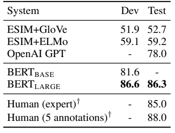

# 组会汇报 · 本周工作

> 汇报日期：2026-10-14
> 本周主线：①精读《BERT》《GPT-3》《Toolformer》；②确定方向；③账号共享项目

---

## 1. 学习汇报

| # | 工作项 | 产出 |
|---|---|---|
| 1 | 精读《BERT》《GPT-3》《Toolformer》，梳理预训练、上下文学习和工具调用的区别 | 三篇精读笔记（.md），BERT轻量微调实验 |
| 2 | 研究方向选择 |  |
| 3 | 账号共享项目 | 账号共享方案-v3.md |

---

### 1.1 论文学习

**一句话结论：**

**BERT 通过预训练获得可迁移的文本表示；GPT-3 展示了不更新参数、依靠上下文示例适应任务的能力；Toolformer 则通过自动构造训练数据，让模型学习生成工具调用。**

三篇论文可以帮助我区分三个问题：模型怎样获得语言能力？推理时怎样向模型说明任务？模型怎样把部分问题交给外部工具？

#### （1）BERT：预训练之后，再针对任务微调

**论文：** *BERT: Pre-training of Deep Bidirectional Transformers for Language Understanding*，Jacob Devlin 等，2018 年首次公开，正式发表于 NAACL-HLT 2019。[原论文](https://aclanthology.org/N19-1423/)

- **研究问题：** 传统从左到右的语言建模限制了对右侧上下文的利用，如何预训练一个能够联合利用左右上下文、迁移到多种语言理解任务的模型？

- **核心方法：** 使用 Transformer Encoder。通过掩码语言建模（MLM）预测被选中的词，通过下一句预测（NSP）学习文本片段之间的关系；下游任务增加少量任务参数，并对模型进行端到端微调。

- **实验结论：** 在 GLUE、SQuAD 和 SWAG 等任务上取得当时有竞争力的结果。例如原论文 Table 4 (如下)中，BERT-Large 在 **SWAG** 测试集的准确率为 **86.3%**，GPT 对照为 **78.0%**，相差 **8.3 个百分点**。这是特定四选一任务结果，不能直接等同于开放式推理或 Agent 规划能力。

  **注：**SWAG = "看场景、猜接下来会发生什么"的四选一考试，干扰项是专门造出来骗模型的，用来测**常识推理**。

  补充一个 BERT 报告里的细节（表 4）：人类专家在这个任务上也只有 **85.0**（基于 100 个样本），而 BERT-Large 是 86.3——所以当时 BERT 在这项上**超过了人类专家**，但是这个"人类 85.0"样本量很小（只测了 100 题），所以不能据此笼统说"BERT 全面超越人类常识"。

  

- **我的理解：** BERT 更适合学习文本表示、分类和信息抽取，并不能直接理解成聊天生成模型。在 Agent 系统中，可以用编码器表示问题和规则，再检索相关证据，但原始 BERT 并不是已经训练好的高质量检索器。

**总结:** 

可以这样理解，**BERT 是一个"阅读理解器"**——它不是会聊天的 AI，而是擅长"读懂一句话/一段话"的模型，用来做分类、找答案、识别实体这类**理解任务**。

BERT 的双向上下文编码，与 GPT 类模型的因果自回归生成不同；MLM 训练也不等于简单预测下一个词。

1. **它是"双向"的**：读一个词时，能同时看到它左边和右边的上下文（以前的模型只能从左往右读）。
2. **靠"填空"训练**：把句子里的词随机挖掉（换成 `[MASK]`），让它猜回原来的词——这就是 MLM（掩码语言建模）。
3. **训练完可以"换头"做各种任务**：加一个小分类头就能做情感判断，换一个头就能做问答、找人名。

2018 年它一出来，在几乎**所有**语言理解榜单上刷新纪录，靠的就是"**先用海量无标注文本预训练，再针对具体任务微调**"这套范式。今天所有大模型（包括 ChatGPT）都沿用这个"预训练 → 微调"的大思路，BERT 是奠基者之一。

#### （2）GPT-3：把任务示例放进输入，而不是再训练一次

**论文：** *Language Models are Few-Shot Learners*，Tom B. Brown 等，NeurIPS 2020。[原论文](https://arxiv.org/abs/2005.14165)

- **研究问题：** 完成不同任务是否都需要专门的有标注训练数据和参数微调？扩大语言模型规模后，能否只用任务描述和少量示例完成任务？

- **核心方法：** 训练自回归语言模型，最大模型为 175B 参数；在下游评价中比较零样本、单样本和少样本设置。示例与待回答问题共同进入上下文，**推理阶段没有梯度更新**。

- **实验结论：** 模型规模和上下文示例能够改善多项任务表现，但效果因任务而异。例如原论文 Table 3.2(下图) 中，175B 模型的少样本设置在 LAMBADA 任务上达到 **86.4%** 准确率。这是根据上下文预测最后一个词的任务，不代表所有任务均达到同样水平。

  **注：**LAMBADA = "读完一整段、猜最后那个词"的考试，专门测模型的长期记忆和上下文关联能力；GPT-3 用它来证明"越大越能读懂上下文"。

  

- **我的理解：** 给模型几个示例相当于在本次输入中说明“这道题应该怎样做”，不是把模型权重重新训练了。这也是上下文学习（ICL）与微调的区别

**需要记住的区别：** GPT-3 论文中的少样本能力，不等于现代聊天模型经过指令微调后的全部能力，也不能据此断言一个很小的模型能达到同样效果。

**GPT-3 不是在 BERT 基础上"优化"出来的，它们俩是同一个祖先（Transformer）分出的两条平行路线，互不继承。**

```
2017  Transformer（Vaswani 等，《Attention Is All You Need》）
          │
          ├── Encoder 部分  ──→  2018.10 BERT（双向，做理解）
          │
          └── Decoder 部分  ──→  2018.06 GPT-1 → 2019 GPT-2 → 2020 GPT-3（单向，做生成）
```

#### （3）Toolformer：让工具返回产生训练数据筛选信号

**论文：** *Toolformer: Language Models Can Teach Themselves to Use Tools*，Timo Schick 等，NeurIPS 2023。[原论文](https://arxiv.org/abs/2302.04761)

- **研究问题：** 语言模型容易在计算、外部事实和时间信息上出错，如何减少人工标注工具轨迹，让模型学会何时调用、调用哪个工具以及怎样利用返回？

- **核心方法：** 主要通过**自监督 + 上下文学习**，整个过程完全**不需要人工标注**，全靠模型自己试错 + 挑好例子。拿一堆无标注文本，让模型在句子里的每个位置都尝试插入一个 API 调用模板（如 `<API>计算器(3+5)</API>`），生成大量"候选调用"。对每个候选调用，去执行这个 API、拿到真实结果，再让模型计算一个"**加权交叉熵损失**（作为自动评分器）"——**如果调用某个 API 后能显著降低后面 token 的预测损失，就说明这个调用"有用"**，把它留下来；没用的一律丢弃。留下的这些例子，把 API 返回结果填回句子，做成"自然语言 + API 调用"的混合序列。用这些混合序列去微调模型，模型就学会了"什么时候该调用工具、调用哪个工具。

- **关键筛选思想：** 收到工具返回并不意味着样本有价值。需要比较“无调用”“调用但无返回”“调用且有返回”三种条件，以前两者中较低的损失为基线，检验真实返回是否带来额外收益。

- **实验结论：** 正式版正文 Table 3 中，SVAMP 数学任务上 GPT-J 为 **5.2%**，Toolformer 为 **29.4%**；同一 Toolformer 禁用工具时为 **6.3%**，开启工具后提高 **23.1 个百分点**。对照说明外部工具在这些任务中有帮助，但不等于模型自身变成了精确计算器，也不意味着所有任务都受益。

- **我的理解：** Toolformer 的重点不是简单写一句“请调用计算器”，而是自动筛选含工具调用的语料，通过训练改变模型行为。工具调用请求由模型生成，执行仍由外部程序完成。

  **Toolformer** 解决的核心问题是：如何让大语言模型（LLM）在不需要人工标注、也不需要额外微调数据的情况下，自己学会"在合适的时候调用外部工具"（计算器、问答系统、搜索引擎、翻译、日历），从而补上 LLM 的短板——算不对数、查不到实时/私有信息、知识过时。

  与之前阅读的 CoT、ReAct 联系起来：CoT 强调输出中间推理步骤；ReAct 强调推理、行动和环境观察交替；Toolformer 强调通过自动数据构造与训练学习工具调用。它们可以组合

---

## 2. 研究方向思考

### 2.1 方向

经过这周的的思考，我觉得还是做偏软一点比较好，一方面好用codex调试，另一方面也能节约成本，但是编故事时可以往具身靠近，下面是我的调研，以及我想做的方向

放到整个**大模型领域**看，2026 年值得重点关注的主线包括：**推理与强化学习后训练、Agent、多模态、推理效率，以及可靠性与安全**。

| 方向                     | 今年重点研究什么                                   | 适合切入的部分                             | 相对实验成本               |
| ------------------------ | -------------------------------------------------- | ------------------------------------------ | -------------------------- |
| **推理与强化学习后训练** | 可验证奖励、奖励设计、训练稳定性、推理是否真实有效 | 推理评估、答案验证、数据筛选               | 完整 RL 训练较高；评估较低 |
| **Agent 与长程决策**     | 多轮工具调用、规划、记忆、技能复用、失败恢复       | **记忆筛选、工作记忆压缩、技能适用性判断** | API 路线较低至中等         |
| **多模态理解与推理**     | 图像／视频理解、证据定位、空间推理、多模态幻觉     | 输出验证、证据筛选、轻量推理改进           | 中等，取决于模型           |
| **高效推理与部署**       | 量化、缓存、压缩、减少推理与调用开销               | 小模型实验、上下文筛选、调用策略           | 中等；部分需较强系统基础   |
| **可靠性与安全**         | 幻觉检测、错误置信度、风险评估、对齐               | **幻觉检测、证据一致性、拒答策略**         | 推理与评估路线较低至中等   |
| **检索增强与知识使用**   | 自适应检索、多跳检索、证据冲突、检索与推理协同     | 检索选择、重排序、证据过滤                 | 较低至中等                 |

放到整个**具身智能领域**，今年明显活跃的主线包括：**VLA 与通用机器人策略、世界模型、具身导航与空间推理、灵巧操作、人形机器人控制，以及长程规划与技能学习**。 

| 主线                     | 在研究什么                                             | 无实体机器人能否开展                   | 对当前条件的适合度                         |
| ------------------------ | ------------------------------------------------------ | -------------------------------------- | ------------------------------------------ |
| **VLA／通用机器人策略**  | 将图像、语言映射到动作，提升新任务与新机器人的泛化     | 能做仿真实验；训练和评估可能较重       | 暂不优先完整训练                           |
| **世界模型**             | 预测执行动作后的环境变化，用于规划、数据生成和策略评估 | 可以，但视频模型训练通常较重           | 可研究小规模状态预测，暂不优先大型生成模型 |
| **具身导航与空间推理**   | 找目标、理解空间关系、利用地图和历史观察导航           | **可以，仿真是重要验证方式**           | **值得重点考虑**                           |
| **操作与动作策略学习**   | 抓取、接触操作、双臂协作、动作表示                     | 可以使用仿真和示范数据                 | 小任务可起步，需补控制与机器人基础         |
| **人形／足式运动控制**   | 行走、平衡、全身协作、移动操作                         | 仿真可以起步，真实迁移另需设备         | 学习与实验负担较高                         |
| **高层规划、记忆与技能** | 任务分解、技能选择、执行检查、失败恢复                 | **可以**                               | **最能衔接已有的 Agent 学习**              |
| **迁移与鲁棒性**         | 仿真到现实、跨机器人迁移、光照与动力学变化             | 可研究部分问题；真实迁移结论需真实证据 | 要根据验证条件收窄                         |

根据我最近看的论文，我觉得做大模型与具身交叉，最后在仿真环境验证。可参考论文多而且新，方便进行模块缝合，而且偏软，好让大模型辅助实验。

比如仿真**具身 Agent 的任务规划与失败恢复**，使用现成的感知模块，把研究重点放在：**智能体如何根据环境反馈，做出更可靠、更省成本的决策。**，倾向先研究**小模型的工具调用可靠性和调用数据质量**，Agent 记忆增强决策”，将技能复用和可靠执行作为相邻参考

比如我可以举个反例 给模型喂存在部分问题的数据集越多 他收到的无用信息太多，反而导致他变笨，所以需要对决策做出判断。

| 选题                                | 具体问题示例                                                 | 优势                                | 需要补的知识                     |
| ----------------------------------- | ------------------------------------------------------------ | ----------------------------------- | -------------------------------- |
| **具身 Agent 的任务规划与失败恢复** | 在仿真环境中规划、记忆与技能任务分解、技能选择、执行检查、失败恢复，当前技能是否可执行？信息不足时先观察还是执行？ | 偏软件，衔接 ReAct、工具调用、Skill | 状态表示、动作前置条件、规划评估 |

---

### 2.2 遇到的问题

1. **概念还需要通过实践巩固：** 阅读时能理解预训练、ICL、微调和工具调用，但还需要亲自观察输入、模型输出、程序返回及参数更新，避免只记住名词。
2. **论文创新不能只看表面结构：** “组合模块”是否构成贡献，需要近期文献检索、公平 Baseline 与消融支持，不能预设适合 SCI 二区或三区投稿。
3. **实验效果与结论范围容易混淆：** 固定模板上的成功，不能直接推广到复杂任务；预测损失下降，也不保证最终任务成功率提高。

---

## 3. 账号共享项目

> 详细见-----账号共享方案-v3.md

---

## 4. 未来规划

### 4.1 计划安排

1. **论文：** 使用之前看的这些论文中的知识，让大模型总结并且生成一个适合学习的项目，让我自己动手跑跑实验看看变化；下周开始将重点关注与研究方向相关的近期论文。
3. **项目：**根据本周的商讨，决定账号共享的下一步走向，是开始pro账号的共享尝试，还是切换方案。
