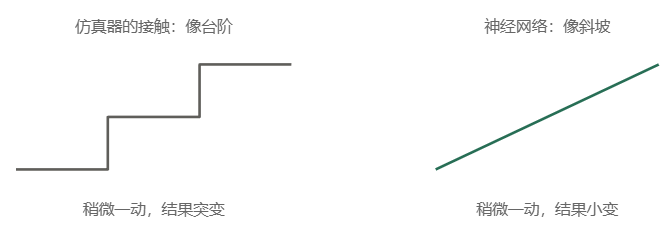

# 组会汇报 · 本周工作

> 汇报日期：2026-10-28
> 本周主线：①论文阅读；②无人机构思

---

## 1. 学习汇报

| # | 工作项 | 产出 |
|---|---|---|
| 1 | 阅读 π0、精准穿越窄缝、SuperMimic | 论文阅读心得与方法对比（见 1.1） |
| 2 | 无人机构思 | 想法拆解图 |

---

### 1.1 论文学习

这周我主要读了三篇论文。它们研究的任务不一样，但对我做机器人和无人机都有启发：

| 论文 | 我主要想从里面弄明白什么 |
|---|---|
| π0 | 怎么把看到的画面、收到的指令，变成机器人能执行的动作？ |
| 无人机穿窄缝 | 不先把整条路线算好，能不能边看边调整，准确飞过去？ |
| SuperMimic | 训练机器人这么费算力，有没有更省的办法？ |

#### （1）π0：让机器人把指令变成连贯的动作

**论文：** *π0: A Vision-Language-Action Flow Model for General Robot Control*，Physical Intelligence，2024 年首次公开，**RSS 2025**。[论文](https://arxiv.org/abs/2410.24164) · [开源实现](https://github.com/Physical-Intelligence/openpi)

**这篇想解决的问题**

现在的大模型可以看图、回答问题，但机器人还得真正动手。比如我说“把桌上的碗摞起来”，它不光要知道碗在哪，还得控制机械臂怎么伸过去、怎么抓、怎么放。作者想做的是：让同一个模型能学会多种任务，也能用在不同类型的机器人上。

**核心方法：**

可以把它分成两部分：一部分处理画面和文字指令也就是基于**VLM（视觉语言模型）** **预训练**和**流匹配**(给每个元素地定好目标位置，同时出发同时到达，但会经过多步，并不是一步到位) 的新颖通用机器人策略架构，另一部分专门生成动作（文中所谓的动作专家）。前一部分用已经学过大量图文的模型，后一部分再用机器人操作数据来训练。

它有个重要设计：**一次生成一小段连续动作。** 比如伸手、靠近、抓住，这些动作要连起来考虑。论文里一次生成未来 50 步的动作，这叫“动作块”。

生成动作时，它先从一组随机数开始，再逐步调整，最后得到合理的动作序列。这种生成方法叫“流匹配”。这里的随机数只是模型计算的起点，机器人不会真的先乱动一遍。

训练上，先让模型看大量不同机器人、不同任务的操作数据，再针对具体任务继续训练。

> 这里其实有个误区：**π0 给了 VLA“连续动作 + flow matching”的范式**，而不是π0这个文章提出了VLA。用 flow matching 的 action expert 输出**连续动作块**（chunk，最高 50Hz），绕开 RT-2/OpenVLA 的离散 token 自回归；后者的时间分辨率低，也不支持 chunk。

**做出来效果怎样**

在论文的多数测试里，π0 比 OpenVLA、Octo 等对比方法表现更好，也展示了叠衣服、收拾餐盘等多步骤操作。提前用大量数据训练，对较难任务的帮助更明显。

论文里较小的模型也有不错的表现。其实在我看来这说明，效果提升和“怎么生成动作”有关，不能只看模型有多大。

**对我的启发和它的不足**

我觉得最值得学的是：**控制机器人时，要考虑一小段动作怎么连起来。**就像一个正常人一样，在做动作时往往会带动全身

但生成未来的动作，不等于已经知道这些动作会造成什么后果。长时间的任务怎么安排、做错之前能不能预警、遇到不合理的指令会不会停下来，这些问题还需要继续研究。

#### （2）无人机穿窄缝：边看边调整姿势，准确飞过去

**论文：** *Precise Aggressive Aerial Maneuvers with Sensorimotor Policies*，浙江大学高飞团队，**Science Robotics**，2026 年。[论文](https://www.science.org/doi/10.1126/scirobotics.aeb0180)

**这篇想解决的问题**

四旋翼机身高度 10 cm，要穿过 20 cm 高的缝，两边各只剩 **5 cm** 余量。而且它不是“平着飞过去”——必须瞬间把机身侧倾到接近 90°，利用机身“薄”的那一面挤过去，也就是论文说的 **SE(3) 约束**（位置和姿态同时被卡死）。传统做法是“估计状态 → 规划轨迹 → 跟踪控制”，每一环都要单独调参，误差还会级联放大。问题是：**能不能跳过这些中间环节，让相机看到的东西直接变成油门和角速度？**

**核心方法：**

实际飞行时，模型接收相机画面和飞机自身的姿态，直接给出总推力和三个方向的转动速度。

训练分两步。先在仿真里训练一个“老师”，让它拿到比较完整的位置等信息，学会穿缝。再训练一个“学生”，让它只用实际飞行时能得到的画面和姿态信息，跟着老师学。学生自己尝试时，老师也会告诉它应该怎么做。这就是“策略蒸馏”。这其实也给我想做的**无人机集群**提供了一点思路，就是老师这个角色在多台无人机同时作业时，共享自己的数据给学生，然后在老师发生故障后，怎么重新选举老师。

另外，作者没有让飞机从完全随机的状态开始乱试。训练前，先用传统规划方法算出一条能通过的路线，再让飞机从路线附近开始练。这样更容易练成功。

为了让仿真里学到的东西能用到真机上，训练时还会改变外观、外力和其他条件，避免它只适应一种理想情况。

- **输入输出都到底层：** 输入是单目相机（1280×1024 降到 320×256）加飞控的姿态角；输出是**总推力 + 三轴角速度**，不经过位置环，也没有“参考轨迹”这个中间量。缝在哪、朝哪、自己该用什么姿态穿，全由策略自己决定。

- **两级训练（全文最关键的工程技巧）：**

  - 第一级：先在“上帝视角”的低维状态上跑强化学习（PPO），先找到一个**确实能穿过去**的解。
  - 第二级：**策略蒸馏**——让只看图像的“学生”去模仿这个“老师”，用在线模仿学习（学生自己飞、老师实时纠正它该出什么指令），而不是拿固定数据集离线模仿。

- **用规划器帮 RL 探索（IR）：** 缝的可通行姿态空间极窄，随机试几乎摸不到。作者先用基于模型的轨迹优化算出一条开环轨迹，再把智能体的初始状态撒在这条轨迹上。效果很直接：**没有 IR 时，要 3 倍样本才能到 70% 成功率；有 IR 时，同样的样本预算能到约 96%。**

- **那IR 是什么**

  一句话：**训练时不总是把无人机重置到悬停起点，而是按模型规划器生成的高质量轨迹，从轨迹上的随机状态（位置、速度、姿态）开始 episode。**

  原文定义：

  > "we propose an *informed reset* (IR) scheme that strategically initializes the agent to states that facilitate effective exploration."
  >
  > 我们提出了一种知情重置(IR)方案，该方案战略性地将代理初始化到促进有效探索的状态

  注意一个细节：它仍然保留一定概率把无人机重置到悬停状态，只是不再只有这一种初值。

  **它在这篇论文里解决什么**

  这是全文最精妙的一段设计，值得讲清楚。

  **问题的具体形态**：连续通过两个窄缝时，过第二个缝之前**必须先减速**。但“减速”在当下会立刻损失“向前推进”的即时奖励。于是 RL 策略被困在一个局部最优里：**一直往前冲，第一个缝过得很好，第二个缝永远撞墙**。

  论文原话：

  > "the required pre-gap deceleration conflicts with the immediate reward structure, causing the RL algorithm to become trapped in suboptimal solutions that prioritize immediate forward progress reward."

  这不是「搜索空间太大」的问题，而是**信用分配**的问题：策略必须先在当下承受一个“看似亏本”的动作，才能在若干步后拿到奖励，但探索很难碰到那条路径。

  **IR 的解决办法**是：直接让 episode 从「已经减速、位于缝前」的状态开始。策略在这个状态里试几次，发现从这里出发能拿到高回报，于是这个状态被纳入策略的「已知可行区」，并逐步向回传播。

  本质上，IR 绕过了信用分配的时间跨度：**把必须经历一长串动作才能到达的关键状态，直接提供给策略。**

- **sim-to-real：** 域随机化（扰动、外力、外观等）。消融显示，在 60°/80° 大倾角下，去掉扰动或外力随机化，成功率会明显下降。

- **硬件：** 自研 38 cm × 10 cm 机架、Jetson Orin NX 机载计算、PX4 飞控；光流模块负责起飞悬停和穿缝后的接管。推力限制在 0.61–2.04 倍重力加速度，最大角速度 6 rad/s。

**对我的启发和它的不足**

这篇和我的无人机构思最直接相关。我想借鉴的是：**穿缝时根据画面及时调整，减少对提前算好整条路线的依赖。**

不过，训练时仍然用到了传统规划方法，飞行时也仍然需要飞机自身的姿态信息，不能理解成“什么都不用算、什么传感器都不要”。

实验里还用了比较容易识别的发光边框。换成普通墙洞、复杂背景或者不同光照后，效果怎样，还需要继续测试。

对我来说，下一步不只是提高成功率，还要考虑：能不能在判断不好通过时，提前减速或者放弃穿越？

#### （3）SuperMimic：先学会预测身体怎么动，再用它练动作

**论文：** *SuperMimic: Scaling Humanoid Whole-Body Control with One Differentiable World Model*，Qiayuan Liao、Yiyang Shao、Junfeng Long 等（UC Berkeley，Pieter Abbeel 与 Koushil Sreenath 共同指导），**CoRL 2026**。[项目主页](https://supermimic.github.io)

- **研究问题：** 人形机器人要会走路、跳舞、翻滚、摔倒后爬起来，现在的主流做法是“模仿动作捕捉数据”：给一段参考动作，用强化学习（PPO**（Proximal Policy Optimization，近端策略优化）**）训一个策略去跟。问题在于，**动作库越大，算力涨得越快**——目前最强的 SONIC 用 128 张 L40 训了 7 天，约 **2.1 万 GPU 小时**。

  > **PPO（Proximal Policy Optimization，近端策略优化）**，2017 年由 OpenAI 提出，是目前最常用的 model-free 策略梯度算法。它的核心思路只有一句：**策略每次只允许小幅度更新，不许一次改太多**，靠对重要性采样比做裁剪（clip）来实现。

  作者指出这里有一处明显的浪费：**动作虽然千差万别，但都是同一个身体在动，动力学是共享的**。而 PPO 完全不去建模这个共享结构，只是反复从仿真里“试”，等于每多加一批动作，就重新摸一遍身体的规律。那就有一个问题：能不能**只学一次“这个身体怎么动”，然后在这一个模型里把所有动作都练完？**

**核心方法：**

一个三步循环，像“**边摸清自己的身体规律、边在脑子里排练**”。

- **第一步，采数据。** 当前策略在仿真里跑，把（状态、动作、奖励、下一状态）存进回放池。

- **第二步，学一个可微的世界模型。** 从回放池里抽 8 步长的片段，训一个动力学模型：
  $$
  \hat{s}_{t+1}=f_\omega(\hat s_t,a_t,\xi),\qquad
  \hat r_{t+1}=r_\omega(\hat s_t,a_t,g_t)
  $$
  其中 $\xi$ 是这一局的仿真参数（摩擦、标定偏差、躯干质心）。**把这些“随机源”作为条件输入，模型本身就可以是确定性的**，不用去学噪声；观测和终止信号也各有一个头。

- **第三步，在想象里练策略。** 冻结世界模型，让策略在模型里“想象”**32 步**，然后沿这条想象出来的轨迹做**反向传播（BPTT）**，直接拿到解析梯度。因为路径上每一步都可微，“这个动作让 32 步后的回报降了多少”能精确算出来，而不是像 PPO 那样靠采样去估。

  > 最关键的一点是：**梯度来自学出来的模型，不是来自仿真器**。所以这套方法能直接配 MuJoCo 这类接触不光滑、本身根本不可微的刚体仿真器——不需要一个“可微仿真器”。
  >
  > **神经网络，它更顺滑：它用「可能有点不准」换来了「处处能求导」。** **台阶上算不出坡度，斜坡上算得出。仿真器的接触是台阶，神经网络是斜坡。**
  >
  > 

**实验结论：**

作者报告，用 **一张 H100 显卡训练约 3 小时**，成绩就超过了拿来比较的 SONIC 发布模型。作为对比，SONIC 的训练用了 128 张 L40、约 7 天。换算下来**墙钟时间省 50 倍以上、GPU 小时省 1000 倍以上**（作者自己算得更细：约 **56 倍**和约 **7200 倍**）。

- 在 12.95 万条动作的共享基准上：3 小时后失败 **25** 条，2 张卡 9.8 小时后失败 **0** 条；SONIC 是 **179** 条。
- 而且它用的数据更少：264.6 小时（BONES SEED 公开子集），比 SONIC 的 611 小时少 2.3 倍。**数据少 2.3 倍、单卡峰值最多差 5.5 倍，乘起来也解释不了 1000 倍的差距**——说明差距来自方法。
- 世界模型为什么顶得住：数据从 1 小时扩到 264 小时（**264 倍**），8 步预测误差一直稳在 **0.007–0.011**。因为所有动作都是同一个身体在做，多加数据是在“补证据”，不是“要求更大容量”。
- 想象比仿真快：实际批量下快 **10 倍以上**，6.4 万并行环境时快 **62 倍**。
- 解析梯度本身也有用：达到“在世界模型上跑 PPO”的最好回报，只需约 **1/64 的想象步数**——**省的不只是“跑得快”，还有“每一步更有用”**。

两边显卡和训练设置不同，我主要关注的是它明显降低了训练成本。论文也在真实的 Unitree G1 人形机器人上展示了跳步、侧滚和翻转等动作。

另外，在论文测试的数据规模内，动作数据增加了很多，预测误差仍然比较稳定。这说明同一个身体的运动规律，确实有机会在不同动作之间重复利用。

**我的理解：**

这篇正好对上我之前记的那句话——**“原来的 VLA 是看懂世界，而现在的 WAM 是为了预测世界”**。这里 WAM 就是 world action model：先有一个能预测“我这样动，世界会怎么变”的模型，再在这个模型里练动作。π0 是“看懂 → 直接出动作”，SuperMimic 是“先学会世界怎么运转 → 再在里面排练”。**这是两种很不一样的范式，而后者把瓶颈从“算力”换成了“模型精度”。**

第二点，它给出的证据里，我觉得**“264 倍数据、预测误差不掉”比“快 1000 倍”更有分量**。因为后者可能只是某个规模上的巧合，前者说明这套东西能随数据规模继续用下去。一个方法能不能扩展，比它当下快多少重要。

第三，我会看清它的边界：世界模型**只从仿真里学**，没碰过真机数据；只在**平地**上训，没有地形和物体交互；多接口联合训练还只是初步。真机验证是 4 个动作“能跑通”，不是大规模成功率统计。所以“1000 倍”是在**仿真训练成本**这个口径下成立的，**不等于真机部署也便宜了 1000 倍**。

最后一点和我自己的项目最相关。**单卡 3 小时**这个数字，意味着这类方法在实验室里是真的跑得起——不用 128 张卡，也不用排队。而且它和窄缝那篇其实在解同一个问题：**解空间很窄的时候，怎么还能有效地探索。** 窄缝那篇是靠一个规划器把初始状态放到“能看见答案的地方”（IR）；SuperMimic 是靠梯度直接告诉你“往哪改”。我如果真要训穿越窄缝的策略，这两条能不能合起来用，是我下周想试的具体方向。

---

## 2.构思我的小飞机

### 2.1 灵感来源

最近逛b站看到几个有意思的项目，再加上读了这几篇论文，我突然有个想法，就是能不能做个底部带有磁吸模块的小型无人机，实现功能的高解耦，同时他还拥有自动避障功能或者是自主飞行功能，这个磁吸模块可以让无人机可以处理许多人类无法处理的场景，比如狭窄有毒环境的作业，狭窄带电环境作业，类似矿洞啊核电站啊等等，但是后面的研究发现狭窄这个问题本身就非常难做，如果一味追求轻而敏捷，那就无法实现携带磁吸模块作业，如果做到250g以上，那就脱离了微型无人机的定义，而且也并不能在狭窄环境作业。中间地带（80–120 g）既不够轻到敏捷，也不够重到能带模块，是最尴尬的档位。 如果能做出第一个样机的话，我后期还希望能够生产多台同样的无人机 实现**无人机集群** 可以在人类不方便操作的场景**通过更换不同模块或者集群中不同无人机携带不同模块进行联合作业**

而且有了supermimic的世界模型方法后我感觉个人电脑好像也能在仿真环境中训练出满意的效果，不需要动辄一两个的实验了

下面是分别是灵感的来源：

[2026年嵌赛国二作品_哔哩哔哩_bilibili](https://www.bilibili.com/video/BV1g2by6DEZx/?spm_id_from=333.1391.0.0&vd_source=9b2306ae3a64db866de72014f83e67cf)

嘉立创开源链接：https://oshwhub.com/djsdjsdjs5 

软件开源链接：https://github.com/masbc666/Multi-Function-ESP32-Debugger

提供了**磁吸模块**的思路

**论文：** *Precise Aggressive Aerial Maneuvers with Sensorimotor Policies*，Tianyue Wu、Guangtong Xu 等（浙江大学高飞团队），**Science Robotics**，2026 年 6 月，11(115): eaeb0180。[论文](https://www.science.org/doi/10.1126/scirobotics.aeb0180)

这篇论文给我的启发是：**让无人机根据相机画面和自身姿态，及时调整推力和转动速度。** 可以把它想成看到障碍后及时做出反应。穿缝时，它不需要先单独算出缝的位置、再规划整条路线，但训练时仍然用到了规划方法。我想借鉴这种控制思路，不过还有一个问题需要验证：**200 克左右的飞机，带上我想做的模块后，还能不能这么灵敏？**

---

## 3. 未来规划

### 4.1 计划安排

1. **论文：**继续看看论文中找找更好的避障或者悬停算法，继续学强化学习
3. **项目：** 继续构思，有条件就跑跑仿真训练，还有更多的功能构思比如断桨怎么飞
